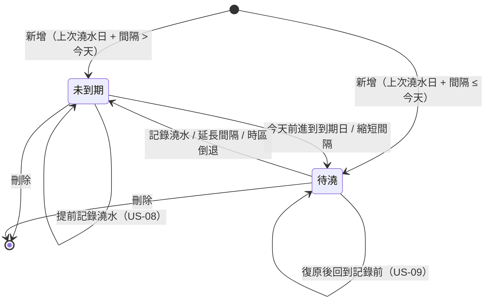

# 領域模型

> 依據：`docs/prd.md` v1.1（已核准）。所有規則實作在 `packages/core`，以 Vitest 與假時鐘測試；UI 只呼叫 core，不自行計算日期或驗證輸入。
> 相關 ADR：ADR-002（儲存）、ADR-004（名稱排序）、ADR-005（復原提示）。

## 值物件

### LocalDate（日曆日期）

- 型別：branded string `LocalDate`，格式固定為 `YYYY-MM-DD`（例：`2026-03-05`）。字典序即時間序，可直接比較，也可直接序列化。
- 只代表「某個時區下的一天」，不帶時、分、時區。
- 運算一律以 UTC 曆法換算（`Date.UTC`），不使用執行環境的本地時區，確保跨月、跨年、閏年 2 月 29 日在任何機器上結果相同。

| 函式 | 說明 |
| --- | --- |
| `parseLocalDate(text: string): LocalDate \| null` | 嚴格解析 `YYYY-MM-DD`；前後空白先去除；不存在的日期（`2026-02-29`、`2026-13-01`）回傳 `null` |
| `addDays(date: LocalDate, days: number): LocalDate` | 加減整數天 |
| `daysBetween(from: LocalDate, to: LocalDate): number` | `to − from` 的天數，可為負 |
| `localDateAt(epochMs: number, utcOffsetMinutes: number): LocalDate` | 某個瞬間在指定 UTC 偏移下的日期 |
| `todayFrom(clock: Clock): LocalDate` | `localDateAt(clock.now(), clock.utcOffsetMinutes(clock.now()))`；PRD 的「今天」唯一的取得方式 |

時區：`Clock.utcOffsetMinutes(epochMs)` 回傳裝置在該瞬間的 UTC 偏移（含日光節約），因此「裝置時區改變時以新時區計算」（PRD Q8）只需重新呼叫 `todayFrom`。單元測試以 `FakeClock.setUtcOffsetMinutes()` 模擬出國。

### PlantId

- 字串 `p<n>`（例：`p1`、`p2`），由 Garden 的 `nextId` 計數器遞增產生，刪除後不重複使用。
- 不使用亂數或 UUID：資料只在單一裝置、單一文件中，計數器足以唯一，且讓測試結果確定，不需要額外的 id 產生器 port。

### 植物名稱、澆水間隔

| 值 | 規則 | 錯誤碼 |
| --- | --- | --- |
| 名稱 | 先去除前後空白（`String.prototype.trim`）；長度 1–30，以 Unicode code point 計算（`[...name].length`，中文一字、emoji 一個 code point 算一字）；儲存去除空白後的值 | `required`（空或只有空白）、`tooLong`、`duplicate` |
| 同名 | 去除前後空白後與另一株植物的名稱完全相同（區分大小寫、全半形，不做正規化）；編輯時排除自己 | `duplicate` |
| 澆水間隔 | 輸入字串去除前後空白後須完全符合 `^[0-9]+$`，數值 1–365 | `required`（空）、`notInteger`（`1.5`、`-3`、`abc`）、`outOfRange`（`0`、`366`） |
| 上次澆水日（只在新增時） | `parseLocalDate` 成功，且 `≤ 今天` | `invalidDate`、`inFuture` |

說明：負數（`-3`）不符合 `^[0-9]+$`，歸為 `notInteger`；畫面上的錯誤文字見 `screens.md`，兩者都只要求「欄位顯示錯誤狀態」（US-01、US-05）。

## 實體

### Plant

| 欄位 | 型別 | 說明 |
| --- | --- | --- |
| `id` | `PlantId` | 不變 |
| `name` | `string` | 已去除前後空白 |
| `intervalDays` | `number` | 1–365 的整數 |
| `lastWateredOn` | `LocalDate` | 最後澆水日 |

衍生值（不儲存，每次由 `today` 計算）：

| 衍生值 | 公式 | PRD 名詞 |
| --- | --- | --- |
| `nextWateringOn` | `addDays(lastWateredOn, intervalDays)` | 到期日 / 下次澆水日 |
| `overdueDays` | `daysBetween(nextWateringOn, today)`（可為負，負數表示未到期） | 逾期天數 |
| `isDue` | `overdueDays ≥ 0` | 待澆 |

MVP 只保存最後澆水日，不保存澆水歷史（PRD 不做清單：澆水歷史列表、修改過去紀錄）。復原所需的前一個值存在 `UndoToken`（記憶體中），見下方。

### Garden（聚合根）

```ts
interface Garden {
  nextId: number; // 下一個 PlantId 的序號，從 1 開始
  plants: Plant[];
}
```

不變條件：

- 任兩株植物的 `name` 不同、`id` 不同。
- 每株植物都符合上表的欄位規則。
- `nextId` 大於所有既有 id 的序號。

## 操作（純函式，回傳新的 Garden）

| 操作 | 輸入 | 結果 | Story |
| --- | --- | --- | --- |
| `addPlant` | `{ name, interval, lastWateredOn }`（皆為字串）、`today` | 成功：新增植物、`nextId + 1`；失敗：回傳每個欄位的錯誤碼，Garden 不變 | US-01 |
| `updatePlant` | `id`、`{ name, interval }`、`today` | 只改名稱與間隔，`lastWateredOn` 不變；失敗時 Garden 不變 | US-05 |
| `removePlant` | `id` | 移除該植物；id 不存在時不變 | US-06 |
| `waterPlant` | `id`、`today` | `lastWateredOn = today`；回傳 `UndoToken { plantId, previousLastWateredOn }` | US-04、US-08 |
| `undoWatering` | `UndoToken` | 植物仍存在時把 `lastWateredOn` 設回 `previousLastWateredOn`；植物已刪除則不變 | US-09 |

驗證一次回報所有欄位的錯誤（不是遇到第一個就停），讓畫面能同時標出多個欄位。

`waterPlant` 的語意：

- 不論是否到期都可以記錄（US-08）；最後澆水日已是今天時，再記錄一次結果不變（US-08 第 3 條）。
- 下次澆水日從實際澆水日起算，不從原到期日起算（US-04 第 2 條），由衍生值公式自然成立。

## 清單與排序

| 清單 | 內容 | 排序 |
| --- | --- | --- |
| 今日待澆（`dueList(garden, today)`） | `isDue` 的植物 | 1. `overdueDays` 由大到小；2. 名稱（`compareNames`）；3. `id` |
| 植物清單（`plantList(garden, today)`） | 全部植物 | 1. 名稱（`compareNames`）；2. `id` |

`compareNames(a, b)`（ADR-004）：

```ts
const collator = new Intl.Collator('zh-Hant-TW', { usage: 'sort', sensitivity: 'variant', numeric: true });
// collator.compare(a, b)，結果為 0 時再以 code point 順序比較，保證全序
```

- 中文依**筆畫**排序（`zh-Hant` 的 CLDR 預設定序）：例 大岩桐（大，3 畫）→ 文竹（文，4 畫）→ 虎尾蘭（虎，8 畫）→ 龜背芋（龜，16 畫）。若依注音則為 大 → 龜 → 虎 → 文，此組名稱可用來驗證。
- 英文依字母（例：Aloe → Basil → Monstera），大小寫只在其餘都相同時才區分（`aloe` 在 `Aloe` 之前）；數字依數值（例：`盆栽2` 在 `盆栽10` 之前）。
- 中文排在拉丁字母之前（CLDR 的 `zh` 定序把漢字移到其他文字之前）；符號與 emoji 開頭的名稱排最前面。
- 以上結果已在 Node（full ICU）確認：`['🌵仙人掌', '大岩桐', '文竹', '虎尾蘭', '盆栽2', '盆栽10', '龜背芋', 'aloe', 'Aloe', 'Basil', 'Monstera']`。裝置上的 Hermes 是否一致見 ADR-004 的風險說明。
- 植物清單的排序 PRD 沒有規定，設計決定沿用名稱排序（需人類確認，見 PR 說明）。

## 狀態轉換

植物的到期狀態完全由 `today` 衍生，不另外儲存：



「待澆」中再以 `overdueDays` 區分「今天到期（0）」與「逾期 N 天」。

## 復原（US-09）

- 按下「已澆水」時立即寫入儲存，並在記憶體中保留 `UndoToken`。
- 復原 = 寫回 `previousLastWateredOn`。因為紀錄已先寫入，提示消失、App 被關閉或切到背景時，紀錄都保留（US-09 第 3 條）。
- 同一時間只保留最新的一個 `UndoToken`：提示顯示期間再記錄另一株，舊提示被取代，舊紀錄保留。
- 提示顯示時間與計時方式見 ADR-005 與 `screens.md`。

## 持久化格式（schema v1）

整個 Garden 存成一份 JSON 文件，鍵為 `garden`（ADR-002）：

```json
{
  "schemaVersion": 1,
  "nextId": 3,
  "plants": [
    { "id": "p1", "name": "龜背芋", "intervalDays": 7, "lastWateredOn": "2026-03-01" },
    { "id": "p2", "name": "虎尾蘭", "intervalDays": 14, "lastWateredOn": "2026-03-01" }
  ]
}
```

- `PlantRepository`（core，非 port）負責序列化、驗證與 schema 遷移：讀到較舊的 `schemaVersion` 時依序套用遷移函式後再使用；讀到較新的版本、JSON 無法解析或不符合不變條件時回報載入錯誤，**不覆寫**原資料。
- 鍵不存在視為空的 Garden（`{ schemaVersion: 1, nextId: 1, plants: [] }`）。
- e2e 的 fixture 使用同一格式（見 `modules.md`），因此 fixture 也會經過遷移與驗證。

## 單元測試必備案例（`packages/core`）

- 日期：跨月（`2026-01-31 + 1`）、跨年（`2026-12-28 + 7`）、閏年（`2028-02-28 + 1 = 2028-02-29`、`2028-02-29 + 365`）、平年 `2026-02-29` 解析失敗。
- 時區：同一瞬間 `2026-03-07T20:00Z` 在 UTC+8 為 `2026-03-08`、在 UTC−5 為 `2026-03-07`；`FakeClock` 改變偏移後 `todayFrom` 與 `dueList` 隨之改變。
- PRD 每條含日期的驗收標準各有一個以假時鐘重現的案例（US-01–US-05、US-08、US-09）。
- 排序：US-03 的 Aloe／Monstera／Basil；上述四個中文名稱的筆畫順序；同名稱比較結果為 0 時以 id 決定。
- 驗證：每個錯誤碼至少一例；名稱邊界 30 / 31 個 code point；間隔 1、365、0、366、`1.5`、`-3`、空字串。
- 儲存：無資料、正常讀寫、未知的較新版本、壞掉的 JSON、寫入失敗時 Garden 狀態不變。
