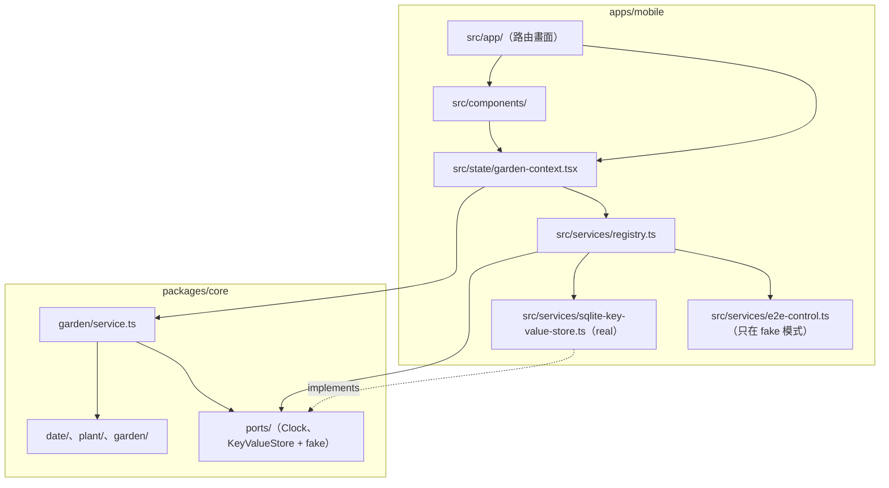

# 模組與 port

> 依據：`docs/prd.md` v1.1、`domain.md`。相關 ADR：ADR-002（本機儲存）、ADR-003（e2e 假時鐘與 fixture 注入）、ADR-004（名稱排序）、ADR-005（復原提示不經 port）。

## 模組邊界



依賴方向只能由上往下：`packages/core` 不 import React、React Native、Expo 或任何平台 API（`Date`、`Intl` 屬於 ECMAScript 標準，可以使用）。畫面不得 import real 實作，只透過 `registry.ts` 取得 services。

## `packages/core` 模組

| 路徑 | 內容 | 匯出（主要） |
| --- | --- | --- |
| `src/ports/clock.ts` | Clock port、`systemClock`、`FakeClock`（**修改**，見下方） | `Clock`、`systemClock`、`FakeClock` |
| `src/ports/key-value-store.ts` | KeyValueStore port 與 `InMemoryKeyValueStore`（**新增**） | `KeyValueStore`、`InMemoryKeyValueStore` |
| `src/date/local-date.ts` | `LocalDate` 與日期運算 | `LocalDate`、`parseLocalDate`、`addDays`、`daysBetween`、`localDateAt`、`todayFrom` |
| `src/plant/plant.ts` | `Plant`、`PlantId`、衍生值 | `Plant`、`PlantId`、`nextWateringOn`、`overdueDays`、`isDue` |
| `src/plant/validation.ts` | 輸入驗證與錯誤碼 | `validateNewPlant`、`validatePlantEdit`、`PlantFieldErrors`、`NAME_MAX_LENGTH`、`INTERVAL_MIN`、`INTERVAL_MAX` |
| `src/plant/sort.ts` | 名稱比較與清單排序 | `compareNames`、`compareDue` |
| `src/garden/garden.ts` | Garden 聚合與純函式操作 | `Garden`、`emptyGarden`、`addPlant`、`updatePlant`、`removePlant`、`waterPlant`、`undoWatering`、`dueList`、`plantList`、`UndoToken` |
| `src/garden/repository.ts` | 序列化、schema 遷移、讀寫 `garden` 鍵 | `PlantRepository`、`GardenDocument`、`GARDEN_STORAGE_KEY`、`GardenLoadError` |
| `src/garden/service.ts` | 應用服務：持有狀態、序列化寫入、通知訂閱者 | `createGardenService`、`GardenService`、`GardenSnapshot`、`PlantView` |
| `src/index.ts` | 公開 API（以上全部） | — |

既有的 `src/duration.ts` 是 template 範例，本設計不使用，也不在本設計中刪除。

### GardenService（UI 唯一的資料入口）

```ts
export interface PlantView {
  id: PlantId;
  name: string;
  intervalDays: number;
  lastWateredOn: LocalDate;
  nextWateringOn: LocalDate;
  overdueDays: number; // 負數 = 未到期
}

export interface GardenSnapshot {
  status: 'loading' | 'ready' | 'error';
  today: LocalDate;
  plants: PlantView[]; // 植物清單排序
  dueList: PlantView[]; // 今日待澆排序，只含 overdueDays >= 0
}

export interface GardenService {
  load(): Promise<void>; // 讀取 + 遷移；失敗時 status = 'error'，不覆寫資料
  getSnapshot(): GardenSnapshot; // 狀態不變時回傳同一個物件（供 useSyncExternalStore）
  subscribe(listener: () => void): () => void;
  refreshToday(): void; // 重新讀取時鐘；日期改變才通知
  addPlant(input: NewPlantInput): Promise<MutationResult<PlantId>>;
  updatePlant(id: PlantId, input: PlantEditInput): Promise<MutationResult<void>>;
  deletePlant(id: PlantId): Promise<void>;
  water(id: PlantId): Promise<UndoToken>;
  undoWatering(token: UndoToken): Promise<void>;
}

export type MutationResult<T> = { ok: true; value: T } | { ok: false; errors: PlantFieldErrors };

export function createGardenService(deps: { store: KeyValueStore; clock: Clock }): GardenService;
```

- 每個變更**先寫入儲存、成功後才更新記憶體狀態並通知**；寫入失敗時 promise reject、狀態不變，UI 顯示儲存失敗提示。
- 變更以佇列依序執行，連續快速點擊不會交錯寫入。
- 驗證所需的 `today` 由 service 在呼叫當下以 `todayFrom(clock)` 取得。

## 外部依賴與 port

| 依賴 | 處理方式 | Port |
| --- | --- | --- |
| 時間（今天、時區） | port | `Clock`（修改既有） |
| 本機儲存 | port | `KeyValueStore`（新增） |
| 復原提示的計時 | **不建 port**，UI 以 `setTimeout` 實作，元件測試以 Jest fake timers 控制（ADR-005） | — |
| App 回到前景事件 | **不建 port**，`apps/mobile` 以 React Native `AppState` 訂閱後呼叫 `refreshToday()`；元件測試 mock `AppState` | — |
| 中文排序（Intl.Collator） | **不建 port**，ECMAScript 標準 API，在 core 直接使用（ADR-004） | — |
| Id 產生 | **不需要**：Garden 內的遞增計數器（`domain.md`） | — |
| 網路 | **不存在**。core 不定義任何網路 port（PRD 非功能需求「離線」，Reviewer 檢查） | — |

### Port 1：Clock（`packages/core/src/ports/clock.ts`，修改）

```ts
export interface Clock {
  /** 目前瞬間，epoch 毫秒。 */
  now(): number;
  /** 裝置在指定瞬間的 UTC 偏移（分鐘，東正西負，含日光節約）。 */
  utcOffsetMinutes(epochMs: number): number;
}

export const systemClock: Clock = {
  now: () => Date.now(),
  utcOffsetMinutes: (epochMs) => -new Date(epochMs).getTimezoneOffset(),
};

export class FakeClock implements Clock {
  constructor(current?: number, utcOffsetMinutes?: number); // 預設 0、0，與現有呼叫相容
  now(): number;
  utcOffsetMinutes(epochMs: number): number; // 回傳目前設定的固定偏移
  advance(ms: number): void; // 既有
  set(epochMs: number): void;
  setUtcOffsetMinutes(minutes: number): void;
  /** 設成指定偏移下該日期的 12:00（避開日界），測試以「今天」描述時使用。 */
  setToday(date: LocalDate): void;
}
```

| 項目 | 內容 |
| --- | --- |
| real 實作 | `systemClock`，與 port 同檔（只用 ECMAScript 的 `Date`，可留在 core） |
| fake 行為 | 時間凍結，不會自己前進；只能由 `advance`／`set`／`setToday` 改變；偏移固定直到 `setUtcOffsetMinutes` |
| fake 模式預設值 | registry 中 `new FakeClock(<2026-01-01T12:00 UTC+8>, 480)`：今天 = `2026-01-01`，時區 UTC+8，不受模擬器時區影響。啟動時若儲存中有 e2e 設定的日期，改用該日期（ADR-003） |
| fixtures | 不需要檔案；日期由測試程式或 e2e deep link 的 `today` 參數直接設定 |

### Port 2：KeyValueStore（`packages/core/src/ports/key-value-store.ts`，新增）

```ts
export interface KeyValueStore {
  getItem(key: string): Promise<string | null>;
  setItem(key: string, value: string): Promise<void>;
  removeItem(key: string): Promise<void>;
}

export class InMemoryKeyValueStore implements KeyValueStore {
  constructor(initial?: Record<string, string>);
  /** 下一次 setItem／removeItem 以此錯誤 reject（測試寫入失敗）。 */
  failNextWrite(error?: Error): void;
  /** 目前所有鍵值的複本，供斷言。 */
  snapshot(): Record<string, string>;
}
```

| 項目 | 內容 |
| --- | --- |
| real 實作 | `apps/mobile/src/services/sqlite-key-value-store.ts`：包裝 `expo-sqlite/kv-store` 的 `Storage`（`getItemAsync`／`setItemAsync`／`removeItemAsync`），資料在 App 沙盒內（ADR-002） |
| fake 行為 | 記憶體 `Map`；寫入立即生效；可注入一次寫入失敗；不跨 process 保存 |
| 使用 fake 的地方 | Vitest 單元測試、Jest 元件測試 |
| fake 模式（`EXPO_PUBLIC_USE_FAKES=1`）的 build | **使用 real 實作**：US-07 需要跨重新啟動保存，而沙盒內的 SQLite 在 Maestro `launchApp: clearState: true` 後必為空，結果仍然確定（ADR-003） |
| fixtures | `fixtures/storage/*.json`，格式即 `domain.md` 的 schema v1 文件，清單見下方「E2E」 |

### Service registry（`apps/mobile/src/services/registry.ts`）

| Service | 一般 build | fake 模式 build（development、e2e profile） | 單元／元件測試 |
| --- | --- | --- | --- |
| `clock` | `systemClock` | `FakeClock`（預設 2026-01-01、UTC+8；可由 e2e deep link 設定） | 測試自建 `FakeClock` |
| `keyValueStore` | `SqliteKeyValueStore` | `SqliteKeyValueStore` | 測試自建 `InMemoryKeyValueStore` |
| `garden` | `createGardenService({ store, clock })` | 同左 | 測試以上述 fake 建立，經 `GardenProvider` 的 prop 注入 |

`apps/mobile/src/state/garden-context.tsx` 提供 `GardenProvider`（可注入 `services`，預設取 registry）、`useGarden()`（以 `useSyncExternalStore` 讀 snapshot）與 `useUndo()`（復原提示狀態）。`GardenProvider` 在 `AppState` 變為 `active` 時呼叫 `garden.refreshToday()`。

## 啟動流程

1. `src/app/_layout.tsx` 掛上 `GardenProvider`，呼叫 `garden.load()`；載入中顯示空白畫面（保留 splash），失敗顯示載入錯誤畫面（`screens.md`）。
2. fake 模式下，`load()` 之前先由 `e2e-control` 讀取儲存中的 e2e 日期設定並套用到 `FakeClock`（ADR-003）。
3. 載入完成後顯示今日待澆清單（US-03 第 1 條：第一個畫面）。

## E2E（Maestro）的假時鐘與 fixture（ADR-003）

### 控制用 deep link（只存在於 fake 模式 build）

```
plantwatering://e2e?fixture=<name>&today=<YYYY-MM-DD>
```

| 參數 | 必填 | 作用 |
| --- | --- | --- |
| `fixture` | 否 | 以 `fixtures/storage/<name>.json` 覆寫 `garden` 鍵 |
| `today` | 否 | 設定 `FakeClock` 為該日 12:00（UTC+8），並把日期寫入儲存鍵 `e2e.today`，重新啟動後仍沿用 |

處理順序：寫入 fixture → 設定日期 → `garden.load()` → 導向 `/`（今日待澆）。flow 以 `assertVisible: id: today-screen` 等待完成。

- 進入點：`src/app/+native-intent.tsx` 的 `redirectSystemPath`，fake 模式時把 `e2e` 連結交給 `src/services/e2e-control.ts` 處理並回傳 `/`；非 fake 模式時 `e2e` 連結只導向 `/`，不讀取參數、不做任何其他事；其他路徑一律原樣回傳。
- fixture 以靜態 `require` 收進 bundle，對照表在 `src/services/e2e-fixtures.ts`；`e2e-control` 與 `e2e-fixtures` 只在 `process.env.EXPO_PUBLIC_USE_FAKES === '1'` 的分支內被 `require`，讓 production bundle 經常數摺疊後不含它們。實作票必須以 `npx expo export`（未設定 `EXPO_PUBLIC_USE_FAKES`）後搜尋 bundle 不含 `e2e.today` 字串來驗證。
- Metro 需能解析 repo 根目錄的 `fixtures/`（Expo monorepo 預設把 workspace 根目錄加入 watchFolders；若不行，於 `metro.config.js` 設定）。

### Flow 範本

```yaml
appId: io.github.yimingc1010.plantwatering
---
- launchApp:
    clearState: true
- openLink: plantwatering://e2e?fixture=monstera-only&today=2026-03-11
- assertVisible:
    id: today-screen
# 中途換日（US-03、US-08）
- openLink: plantwatering://e2e?today=2026-03-12
- assertVisible:
    id: today-screen
```

重新啟動（US-07、效能）：`stopApp` 後 `launchApp`（不加 `clearState`），儲存與 `e2e.today` 都保留。

### Fixtures（`fixtures/storage/`）

| 檔案 | 內容 | 使用的 story |
| --- | --- | --- |
| `monstera-only.json` | 龜背芋（7 天，最後 2026-03-01） | US-03、US-04、US-05、US-08、US-09 |
| `monstera-sansevieria.json` | 龜背芋（7 天，2026-03-01）、虎尾蘭（14 天，2026-03-01） | US-02、US-04、US-06 |
| `sort-latin.json` | Basil（10 天，2026-03-01）、Monstera（7 天，2026-03-01）、Aloe（7 天，2026-03-01）；2026-03-11 時逾期 0／3／3 天 | US-03 排序 |
| `sort-zh-stroke.json` | 龜背芋、虎尾蘭、文竹、大岩桐，同一天到期 | US-03 中文排序（ADR-004） |
| `plants-200.json` | 200 株，名稱 `植物001`–`植物200`，間隔與日期以固定規則產生，2026-03-11 時約一半待澆；由 `fixtures/storage/generate-plants-200.mjs` 產生後納入版控 | 效能（非功能需求） |

空清單不需要 fixture：`clearState: true` 後即為空。

### 各 story 的驗證分配

| Story | 單元（Vitest） | 元件（Jest + RNTL） | E2E（Maestro） |
| --- | --- | --- | --- |
| US-01 新增 | 驗證、新增、逾期計算 | 表單錯誤狀態、取消 | `us-01-add-plant.yaml`：新增成功、逾期 2 天、一種錯誤狀態 |
| US-02 植物清單 | 下次澆水日 | 空狀態與入口 | `us-02-plant-list.yaml` |
| US-03 今日待澆 | 待澆判斷、排序、時區 | **回到前景換日**（FakeClock + mock `AppState`） | `us-03-today-list.yaml`（含換日、拉丁與中文排序、Android 飛航模式）、`us-03-today-list-200-plants.yaml`（3000 ms） |
| US-04 記錄澆水 | `waterPlant` | 按下後清單更新 | `us-04-water-plant.yaml`（含 Android 飛航模式、1000 ms） |
| US-05 編輯 | `updatePlant`、同名排除自己 | 錯誤時原值不變 | `us-05-edit-plant.yaml` |
| US-06 刪除 | `removePlant` | 確認與取消 | `us-06-delete-plant.yaml` |
| US-07 本機保存 | repository 讀寫、遷移 | — | `us-07-persistence.yaml`（`stopApp` → `launchApp`） |
| US-08 提前記錄 | 同日再記錄不變 | — | `us-08-water-early.yaml`（含換日） |
| US-09 復原 | `undoWatering` | **提示逾時後紀錄保留**（Jest fake timers）、復原 | `us-09-undo-watering.yaml`（只驗證顯示與按下復原） |

既有的 `e2e/maestro/us-00-smoke.yaml` 斷言 template 首頁的 `home-title`，換成今日待澆畫面時要一併改為斷言 `today-screen` 與 `app-version`（`app-version` 移到植物清單頁尾，見 `screens.md`）。

### 「Android e2e 開啟飛航模式」在 CI 的可行性

結論：**可行，採用 Maestro 的 `setAirplaneMode`，不需修改 workflow**；第一張含此 flow 的票需在 CI 的 `android` job 實證，失敗時改用下方替代方案。

- Maestro 提供 `setAirplaneMode: enabled | disabled`，官方文件標明只支援 Android，在 iOS 模擬器上不做任何事（模擬器沒有飛航模式），所以同一份 flow 可以兩個平台共用。為了可讀性仍包在 `runFlow: when: platform: Android` 內。
- Maestro 透過 adb 與模擬器溝通，adb 走模擬器的本機通道，不受飛航模式影響；CI 的 emulator 使用 `google_apis` image（可取得 adb root），切換飛航模式不需要額外權限。
- 在 `us-03-today-list.yaml` 與 `us-04-water-plant.yaml` 開頭開啟飛航模式，並在 flow 檔頭的 `onFlowComplete` 關閉，避免失敗時影響後續 flow（本 App 的 flow 本來就不需要網路，殘留也不影響結果）。
- 本 App 的 fake／e2e build 沒有安裝 `expo-updates`，也沒有任何網路呼叫，飛航模式測試的作用是防止日後誤加網路依賴後才發現。

替代方案（若 `setAirplaneMode` 在 API 35 模擬器上無效）：

1. 由人類修改 `.github/workflows/ci-e2e.yml`（受保護路徑），在 `npm run e2e` 前執行 `adb shell cmd connectivity airplane-mode enable`，flow 內移除 `setAirplaneMode`。
2. 若仍不可行：以靜態保證取代 —— Reviewer 檢查 core 沒有網路 port、`apps/mobile` 沒有 `fetch`／`XMLHttpRequest`／`WebSocket` 呼叫（可加 ESLint `no-restricted-globals` 規則），飛航模式改列入 `docs/qa/device-test.md` 的人工驗收。

iOS 沒有對應能力，離線保證在 iOS 上依賴同一份 JS 與上述靜態檢查。

## 原生層變更

- 新增 `expo-sqlite`（以 `npx expo install expo-sqlite` 加入），含原生模組，相關票要加 `native-change` label。kv-store 不需要 config plugin 選項與任何權限，`Info.plist`／manifest 不會新增權限（ADR-002）。
- `apps/mobile/app.json` 的 `expo.name` 改為「澆水日記」（PRD Q9）。
- 不新增日期選擇器、通知、相機等原生套件。

## 給拆票的提示

- 契約票（先合併）：`Clock` 修改與 `KeyValueStore` port、core 公開型別（`LocalDate`、`Plant`、`GardenSnapshot`、`GardenService` 介面）、路由骨架與 testID 常數、registry 的 services 介面。
- `e2e-control` + fixtures + `+native-intent` 是所有 e2e 票的共同前置，應自成一票並先合併。
- `expo-sqlite` 的 real 實作與 registry 接線自成一票，標 `native-change`。
