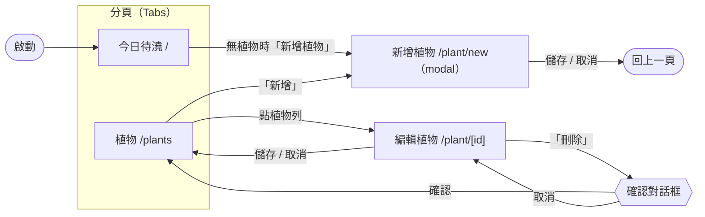

# 畫面與導覽

> 依據：`docs/prd.md` v1.1、`domain.md`、`modules.md`。視覺數值見 `tokens.md`。
> 介面文字只有繁體中文（PRD 非功能需求「語言」），集中在 `apps/mobile/src/strings.ts`。

## 導覽結構

## 路由（`apps/mobile/src/app/`）

| 檔案 | 路徑 | 畫面 | 呈現 | Story |
| --- | --- | --- | --- | --- |
| `_layout.tsx` | — | 根 Stack；掛 `GardenProvider`、復原提示與錯誤提示的 host；載入中／載入錯誤 | — | US-03、US-09 |
| `(tabs)/_layout.tsx` | — | 底部分頁：今日、植物 | Tabs | — |
| `(tabs)/index.tsx` | `/` | 今日待澆 | 分頁 | US-03、US-04、US-09 |
| `(tabs)/plants.tsx` | `/plants` | 植物清單 | 分頁 | US-02、US-08、US-09 |
| `plant/new.tsx` | `/plant/new` | 新增植物 | modal | US-01 |
| `plant/[id].tsx` | `/plant/[id]` | 編輯植物（含刪除） | push | US-05、US-06 |
| `+native-intent.tsx` | — | 不是畫面；處理 e2e deep link（ADR-003） | — | — |

現有 template 的 `index.tsx`（首頁）由 `(tabs)/index.tsx` 取代。分頁使用 `expo-router` 內建的 `Tabs`。

## testID 規則

- 格式：`<畫面或元件>-<元素>`，全小寫、以 `-` 連接。
- 清單列以**顯示順序的索引**（從 0 開始）編號：`today-item-0`、`today-item-0-name`。flow 依索引選取，再以 `text` 斷言內容（例：`assertVisible: { id: today-item-0-name, text: Aloe }`），不以畫面文字選取元素。
- 常數集中在 `apps/mobile/src/test-ids.ts`，畫面與元件測試共用；Maestro flow 直接寫字串。
- 分頁按鈕以 Tabs 的 `tabBarButtonTestID` 設定。

## 共用元件（`apps/mobile/src/components/`）

| 元件 | 用途 |
| --- | --- |
| `PlantForm` | 新增與編輯共用的表單；欄位、錯誤文字、儲存／取消 |
| `DueRow` | 今日待澆的一列 |
| `PlantRow` | 植物清單的一列 |
| `EmptyState` | 空狀態（訊息 + 選用的按鈕） |
| `Snackbar` | 底部提示；復原提示與儲存失敗提示共用 |
| `ConfirmDialog` | 自製確認對話框（RN `Modal`）；不用系統 `Alert`，因為系統對話框的按鈕無法設定 testID |

## 畫面

### 今日待澆（`/`，第一個畫面）

| 元素 | testID | 內容 |
| --- | --- | --- |
| 畫面容器 | `today-screen` | 標題「今日待澆」 |
| 清單列 | `today-item-<i>` | 依 `dueList` 排序（逾期多的在前，同天數依名稱） |
| 名稱 | `today-item-<i>-name` | 植物名稱，可換行，不截斷 |
| 狀態 | `today-item-<i>-status` | 逾期 0 天：「今天到期」；N 天：「逾期 N 天」 |
| 已澆水按鈕 | `today-item-<i>-water` | 「已澆水」；無障礙標籤「<名稱>，已澆水」 |
| 空狀態 | `today-empty` | 有植物但都未到期：「今天沒有要澆的植物」；完全沒有植物：「還沒有植物」 |
| 空狀態按鈕 | `today-empty-add` | 只在完全沒有植物時顯示：「新增植物」→ `/plant/new` |
| 分頁按鈕 | `tab-today`、`tab-plants` | 「今日」、「植物」 |

行為：

- 按「已澆水」→ `garden.water(id)` → 該列消失（US-04）→ 顯示復原提示（US-09）。
- `AppState` 回到 `active` 時重新計算今天（US-03 第 6 條）。

### 植物清單（`/plants`）

| 元素 | testID | 內容 |
| --- | --- | --- |
| 畫面容器 | `plants-screen` | 標題「植物」 |
| 新增按鈕 | `plants-add` | 標題列右側「新增」→ `/plant/new` |
| 清單列 | `plant-item-<i>` | 依名稱排序；整列可點 → `/plant/[id]` |
| 名稱 | `plant-item-<i>-name` | 植物名稱 |
| 間隔 | `plant-item-<i>-interval` | 「每 7 天」 |
| 最後澆水日 | `plant-item-<i>-last-watered` | 「上次 2026-03-01」 |
| 下次澆水日 | `plant-item-<i>-next-watering` | 「下次 2026-03-08」；已到期時以警示色顯示 |
| 已澆水按鈕 | `plant-item-<i>-water` | 「已澆水」，**不論是否到期都顯示**（US-08）；無障礙標籤「<名稱>，已澆水」 |
| 空狀態 | `plants-empty` | 「還沒有植物」 |
| 空狀態按鈕 | `plants-empty-add` | 「新增植物」→ `/plant/new`（US-02 第 2 條） |
| 版本 | `app-version` | 頁尾「版本 <version>」（沿用 template，供 smoke flow） |

### 新增植物（`/plant/new`，modal）

| 元素 | testID | 內容 |
| --- | --- | --- |
| 畫面容器 | `plant-form-screen` | 標題「新增植物」 |
| 名稱 | `plant-name-input` | 標籤「名稱」，提示「最多 30 個字」 |
| 澆水間隔 | `plant-interval-input` | 標籤「澆水間隔（天）」，數字鍵盤，提示「1–365」 |
| 上次澆水日 | `plant-last-watered-input` | 標籤「上次澆水日」，預設今天，格式 `YYYY-MM-DD`（文字輸入，見下方說明） |
| 欄位錯誤 | `plant-name-error`、`plant-interval-error`、`plant-last-watered-error` | 只在該欄位有錯誤時出現，文字見下表；輸入框同時換成錯誤色外框 |
| 儲存 | `plant-save` | 「儲存」：驗證成功 → 關閉 modal；失敗 → 標出所有錯誤欄位，不新增 |
| 取消 | `plant-cancel` | 「取消」：不儲存，關閉 modal（US-01 最後一條） |

上次澆水日使用文字欄位而不是系統日期選擇器：

- PRD 要求輸入未來日期後顯示錯誤狀態（US-01 第 3 條），系統日期選擇器通常直接禁止未來日期，無法呈現這個狀態。
- 系統日期選擇器是原生元件，Maestro 只能以畫面文字操作，違反「以 testID 選取」的規則，且要新增原生套件。
- 代價是輸入較不方便；多數情況使用者保留預設的今天。此取捨列為需人類確認事項。

### 編輯植物（`/plant/[id]`）

與新增共用 `PlantForm`，差異：

| 元素 | testID | 內容 |
| --- | --- | --- |
| 畫面容器 | `plant-form-screen` | 標題「編輯植物」 |
| 上次澆水日 | `plant-last-watered-value` | 唯讀文字「上次澆水日 2026-03-01」（PRD 只允許改名稱與間隔） |
| 刪除 | `plant-delete` | 「刪除植物」，危險色 |
| 確認對話框 | `confirm-dialog` | 「要刪除「<名稱>」嗎？」 |
| 確認刪除 | `confirm-dialog-confirm` | 「刪除」→ 刪除後回到植物清單（US-06） |
| 取消刪除 | `confirm-dialog-cancel` | 「取消」→ 關閉對話框，資料不變 |

儲存失敗（驗證錯誤）時欄位保留使用者輸入、顯示錯誤，儲存的資料不變（US-05 第 3 條）。id 不存在（例：植物已被刪除）時返回植物清單。

### 復原提示（全域 `Snackbar`）

| 元素 | testID | 內容 |
| --- | --- | --- |
| 提示 | `undo-snackbar` | 「已記錄「<名稱>」澆水」 |
| 復原按鈕 | `undo-button` | 「復原」→ `garden.undoWatering(token)`，提示關閉 |

- 顯示 **5 秒**（`tokens.md` 的 `duration.undoSnackbar`），時間到自動消失，紀錄保留（ADR-005）。
- 掛在根 layout，在兩個分頁、任何畫面都顯示；位於分頁列上方，不遮住分頁按鈕。
- 再按另一株的「已澆水」時，以新提示取代舊提示，舊紀錄保留。
- 無障礙：`accessibilityLiveRegion="polite"`，並在出現時以 `AccessibilityInfo.announceForAccessibility` 朗讀訊息。

### 儲存失敗提示

| 元素 | testID | 內容 |
| --- | --- | --- |
| 提示 | `error-snackbar` | 「儲存失敗，請再試一次」，5 秒後消失；畫面狀態維持寫入前 |

### 載入中與載入錯誤（根 layout）

| 狀態 | testID | 內容 |
| --- | --- | --- |
| 載入中 | — | 保留 splash，不顯示內容 |
| 載入錯誤 | `load-error` | 「無法讀取資料」；不提供清除資料的按鈕（避免誤刪），資料保持原狀 |

## 錯誤文字

| 錯誤碼 | 欄位 | 文字 |
| --- | --- | --- |
| `required` | 名稱 | 請輸入名稱 |
| `tooLong` | 名稱 | 名稱最多 30 個字 |
| `duplicate` | 名稱 | 已有同名的植物 |
| `required` | 間隔 | 請輸入澆水間隔 |
| `notInteger` | 間隔 | 請輸入整數天數 |
| `outOfRange` | 間隔 | 間隔須為 1–365 天 |
| `invalidDate` | 上次澆水日 | 請以 YYYY-MM-DD 格式輸入日期 |
| `inFuture` | 上次澆水日 | 上次澆水日不能晚於今天 |

## 顯示格式

| 值 | 格式 | 範例 |
| --- | --- | --- |
| 日期 | `YYYY-MM-DD`（與 PRD 驗收標準一致，e2e 可直接斷言） | `2026-03-08` |
| 間隔 | `每 N 天` | `每 7 天` |
| 待澆狀態 | `今天到期`／`逾期 N 天` | `逾期 3 天` |

## 無障礙（PRD 非功能需求）

- 每個按鈕：`accessibilityRole="button"` 與 `accessibilityLabel`；清單上的「已澆水」標籤包含植物名稱。
- 每個輸入框：`accessibilityLabel` 為欄位標籤；有錯誤時 `accessibilityHint` 為錯誤文字，錯誤文字本身為 `accessibilityLiveRegion="polite"`。
- 觸控目標至少 44×44 pt（`tokens.md` 的 `size.minTouch`），以 `minHeight`／`hitSlop` 達成。
- 不設定 `numberOfLines`、不關閉 `allowFontScaling`；列的版面以換行容納最大字級，按鈕隨字級長高。
- 元件測試斷言每個按鈕與輸入框都有 `accessibilityLabel` 與 `accessibilityRole`。
